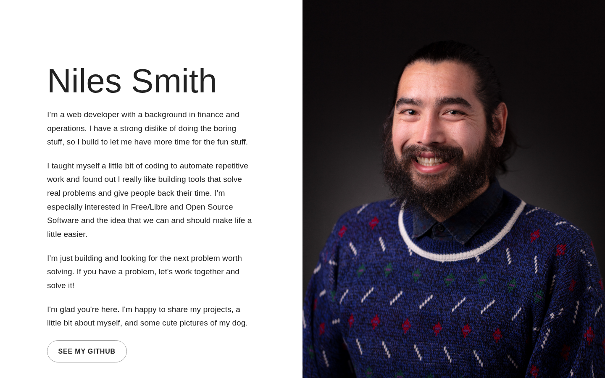
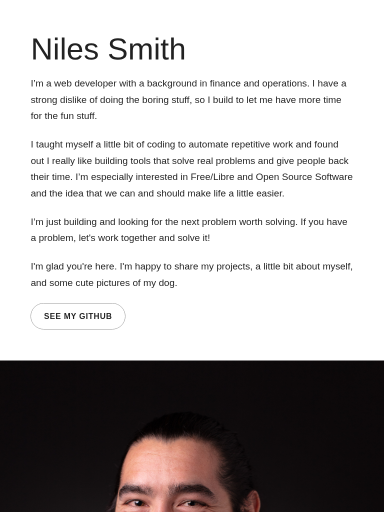
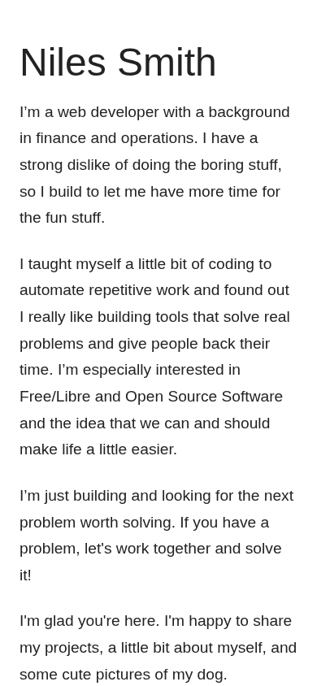

# Niles Smith — Portfolio

My personal portfolio for selected web development projects and professional contact information.

## Overview

This repository contains the source for my portfolio website.

The site introduces my background and current development focus, presents selected projects with desktop, tablet, and mobile project views, includes an image gallery with lightbox behavior, and provides links to GitHub and other professional profiles.

## Featured Projects

The current portfolio includes:

- Two Street Water Ice
- Level Ground
- Japanese Women's Leadership Initiative (JWLI)

Each featured project includes a short description, a project link, and responsive screenshots.

## Technologies

<p>
  <a href="https://developer.mozilla.org/en-US/docs/Web/HTML" title="HTML">
    
  </a>
  &nbsp;
  <a href="https://developer.mozilla.org/en-US/docs/Web/CSS" title="CSS">
    
  </a>
  &nbsp;
  <a href="https://developer.mozilla.org/en-US/docs/Web/JavaScript" title="JavaScript">
    
  </a>
  &nbsp;
  <a href="https://git-scm.com/" title="Git">
    
  </a>
  &nbsp;
  <a href="https://github.com/" title="GitHub">
    
  </a>
</p>

- [GitHub Pages](https://pages.github.com/)

## How to Run

1. Clone the repository:

```bash
git clone https://github.com/nilesleesmith/nilesleesmith.github.io.git
```

2. Open the project folder.

3. Open `index.html` in a web browser.

No additional packages or build steps are required.

## Live Site

https://nilesleesmith.github.io/

## Screenshots

### Desktop



### Tablet



### Mobile



## Attribution

The site includes design inspiration credited in the footer to [HTML5 UP](https://html5up.net/).
